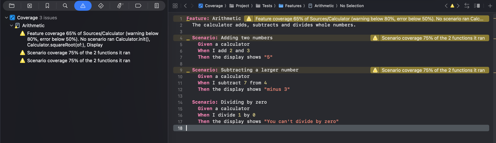

# Coverage

Code coverage for each scenario: a macOS unit test bundle runs a feature file against a framework,
and CucumberSwift writes the coverage of each scenario to a file.

**CucumberSwift version:** 6.8.0 or later, the first release that writes coverage.

[Coverage in the documentation](https://cucumberswift.org/CucumberSwiftSample/documentation/cucumberswiftsample/coverage/) says what it shows, its platform and test target, and the Xcode and CucumberSwift it needs.

## What it shows

The sample has five parts:

- `Sources/Calculator`, the framework that the scenarios cover. `squareRoot(of:)` has no
  scenario, so a report shows it as not covered.
- `Tests/Features/Arithmetic.feature`, a feature file with three scenarios, and
  `Tests/StepDefinitions.swift`, the steps for it.
- `Project.swift`, whose scheme turns on code coverage for the `Calculator` framework only,
  and sets two environment variables for the tests: `CUCUMBER_COVERAGE`, which turns on
  CucumberSwift's coverage files, and `CUCUMBER_COVERAGE_PATH`, the folder they go to.
- `report.py`, which reads those files and prints how much of `Sources/Calculator` each
  scenario covered.
- `annotate.py` and `CoverageAnnotations`, a plugin that shows each scenario's coverage on its
  line in the feature file, as Xcode warnings and errors.

## Run it

You need Xcode 16.3 or later and [mise](https://mise.jdx.dev), which installs the version of
[Tuist](https://tuist.dev) this repository pins. Until CucumberSwift 6.8.0 is released, build
the sample against a CucumberSwift checkout that has the feature: see
[Use a local CucumberSwift checkout](../../README.md#use-a-local-cucumberswift-checkout). From the
repository root:

```bash
mise install
mise run generate
open Tuist/Coverage/Coverage.xcodeproj
```

Press ⌘U to run the tests, then read the coverage of each scenario:

```bash
python3 Tuist/Coverage/report.py
```

From the command line, `mise run test Coverage` generates the project and runs its tests. It
fails unless the tests write a manifest and a coverage file for each scenario.

## What CucumberSwift writes

Each run writes a folder, `coverage/run-<id>`, next to `Project.swift`. The folder contains a `manifest.json`
and one `.profraw` file for each scenario and each binary that was built with code coverage:

```
coverage/run-8A2A457D-3BFF-4C6F-9866-6C1123BB6772/
    manifest.json
    S0001-L4-Calculator.profraw
    S0002-L9-Calculator.profraw
    S0003-L14-Calculator.profraw
```

The manifest lists the binaries and each scenario that ran, with its feature, name, line, tags
and files. A file's name starts with the scenario's position in the run and its line in the
feature file. Each file contains the coverage of one scenario only.

`report.py` merges a scenario's files with `llvm-profdata` and reads them with `llvm-cov`, both
from Xcode. It prints each scenario's coverage of the functions it ran, and what all the scenarios
covered of the code in `Sources/Calculator`:

```
Each scenario, of the functions it ran:
  Scenario                           Regions  Covered   Functions run
  Adding two numbers                  3/4         75%   2
  Subtracting a larger number         3/4         75%   2
  Dividing by zero                    6/7         86%   2

All scenarios together, of all the code in Sources/Calculator: 11/17 regions, 65%
```

## See the coverage on the feature file

The scheme runs `annotate.py` after the tests. It reads the newest run and writes
`coverage/annotations.txt`, and the `CoverageAnnotations` plugin prints those lines on the next
build, so Xcode shows them at the feature file's lines. Press ⌘U, then ⌘B, and open
`Tests/Features/Arithmetic.feature`:

- Each scenario below the warning level has a warning on its line: "Scenario coverage 75% of the 2
  functions it ran".
- The `Feature:` line has the coverage of all the scenarios together, of all the code in
  `Sources/Calculator`, and names the functions that no scenario ran.



A scenario or feature below 80% is a warning, and below 50% an error, which fails the build. Set
other levels with `CUCUMBER_COVERAGE_WARNING_LEVEL` and `CUCUMBER_COVERAGE_ERROR_LEVEL`. Xcode shows
only warnings and errors, so a scenario at or above the warning level has no line. The annotations
come from the files of the last test run, so they stay until you run the tests again.

The annotations are this sample's own code, not part of CucumberSwift. Copy `annotate.py`,
`coverage_tools.py` and `CoverageAnnotations` into your project, and change `CODE` in
`coverage_tools.py` to the folder you measure.

## Check the feature files as you build

`Project.swift` adds CucumberSwift's `CucumberSwiftLint` plugin to the test target, so each
build checks the feature files and shows each problem as a warning at its line. It has no
warnings for this sample. Keep it on for a build server too, with `-skipPackagePluginValidation`: see
[GettingStarted](../GettingStarted/README.md#check-the-feature-files-as-you-build).

## Turn it on in your own project

Set `CUCUMBER_COVERAGE` to `YES` in the test environment, and build the targets you want
measured with code coverage: in Xcode, the **Code Coverage** option of the scheme or test plan,
and in a Swift package, `swift test --enable-code-coverage`. To choose the folder, set
`CUCUMBER_COVERAGE_PATH`. Both have a static variable on `Cucumber` too, `Cucumber.coverage` and
`Cucumber.coveragePath`, which you set in `setupSteps()`. In the scheme, Xcode expands
`$(PROJECT_DIR)` in an environment variable only when the scheme expands variables based on a
target, as `Project.swift` sets it with `expandVariableFromTarget`.

CucumberSwift measures only the binaries built with code coverage, so a prebuilt framework isn't
measured. With the Swift Testing runner, coverage and parallel testing are mutually exclusive:
CucumberSwift runs the scenarios one at a time while coverage is on. See
[Measuring code coverage](https://cucumberswift.org/CucumberSwift/documentation/cucumberswift/measuring-code-coverage)
for the limits.

## Learn more

CucumberSwift's documentation goes further:

- [Measuring code coverage](https://cucumberswift.org/CucumberSwift/documentation/cucumberswift/measuring-code-coverage)
  in CucumberSwift's documentation.
- [GettingStarted](../GettingStarted/README.md), the smallest working setup.
