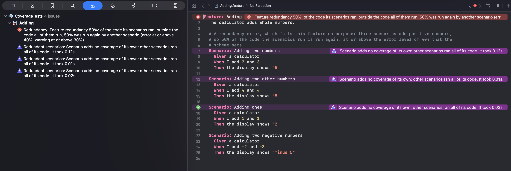

# Coverage

The Coverage sample shows CucumberSwift's code coverage and redundancy scores for each feature. A
macOS unit test bundle runs feature files against 2 frameworks. Each feature file raises one issue
on purpose, and an optimized version next to it fixes the issue.

**CucumberSwift version:** 6.8.1 or later. Coverage only warns by default in 6.8.1, so the scheme sets the error levels.

[Coverage in the documentation](https://cucumberswift.org/CucumberSwiftSample/documentation/cucumberswiftsample/coverage/) says what it shows, its platform and test target, and the Xcode and CucumberSwift it needs.

## What it shows

The sample has 5 pairs of feature files in `Tests/Features`. The first file of each pair raises an
issue, and its `-optimized` version raises none:

| Feature file | Issue | Optimized version |
|---|---|---|
| `Dividing.feature` | A coverage warning: 67%, at or below 80% | Adds a scenario that divides by zero: 90% |
| `Classifying.feature` | A coverage error: 44%, at or below 50% | Classifies a number for each case of `classify(_:)`: 100% |
| `Subtracting.feature` | A redundancy warning: 33%, at or above 30% | Removes the redundant scenario: 0% |
| `Adding.feature` | A redundancy error: 50%, at or above 40% | Adds the positive numbers in one Scenario Outline: 0% |
| `ProfileMenu.feature` | A redundant step warning on each `When` step | Opens the menu in the Background: no warnings |

The scenarios test 2 frameworks. `Sources/Calculator` adds, subtracts, divides and classifies
numbers, and `Sources/Account` has the profile menu.

CucumberSwift records each feature's issues in 2 tests of its own, `Coverage` and `Redundancy`. They
run after the feature's scenarios, in a suite named after the feature, such as
`Adding › Coverage scores`. The errors fail Classifying's `Coverage` test and Adding's `Redundancy`
test on purpose. Every scenario passes.

`Project.swift` builds both frameworks with code coverage, and CucumberSwift measures coverage
whenever the tests are built with it. The scheme sets 3 environment variables:

- `CUCUMBER_COVERAGE_ERROR_LEVEL` sets the coverage error level to 50%. It is off by default.
- `CUCUMBER_REDUNDANCY_ERROR_LEVEL` sets the redundancy's error level to 40%. It is off by default.
- `CUCUMBER_COVERAGE_PATH` sets the folder for each scenario's coverage file.

## Run it

You need Xcode 16.3 or later and [mise](https://mise.jdx.dev), which installs the version of
[Tuist](https://tuist.dev) this repository pins. From the repository root:

```bash
mise install
mise run generate
open Tuist/Coverage/Coverage.xcodeproj
```

Press ⌘U to run the tests, then open each feature file in `Tests/Features`. Classifying's and
Adding's `Coverage scores` suites fail on purpose with the errors.

From the command line, `mise run test Coverage` generates the project and runs its tests. It fails
unless those are the only failures, each feature scores in its range, and each redundant step is
where this README says.

## Read the scores

CucumberSwift prints each feature's scores when the feature finishes. Each scenario's line gives
its share of the coverage, the regions that no other scenario ran, and its time:

```
CucumberSwift coverage: Subtracting: 100% of the code its scenarios ran (4 of 4 regions in 2 functions), 9% of all measured code, redundancy 33%, about 0.02 s of 0.06 s in redundant scenarios
    Share  Own regions      Time  Scenario
      29%            0     0.02s  Subtracting a larger number (line 10)
      42%            1     0.02s  Subtracting a smaller number (line 14)
      29%            0     0.02s  Subtracting another larger number (line 18, adds no coverage of its own)
```

Xcode shows each issue in the feature file. A coverage issue is on the `Feature:` line, and names
the functions whose code no scenario ran:

```
Feature coverage 44%: its scenarios ran 4 of the 9 regions in the 1 function they entered (error at or below 50%, warning at or below 80%). Not run: Calculator.classify(Int), 5 regions, entered by the scenario at line 10.
```

Xcode 26 shows the warnings in the feature files. With Xcode 16.3, CucumberSwift prints them
instead, and still records the errors.

### Raise the coverage

`Dividing.feature` has a coverage warning. Its only scenario divides 6 by 2, so it runs 4 of the 6
regions in the functions it enters. That is 67%, at or below the warning level of 80%.


`Dividing-optimized.feature` adds a scenario that divides by zero:

```gherkin
Scenario: Dividing by zero
  When I divide 6 by 0
  Then the display shows "You can't divide by zero"
```

The 2 scenarios run 9 of 10 regions, or 90%, so the warning goes away.

`Classifying.feature` has a coverage error. Its only scenario classifies 7, so it runs 4 of the 9
regions in `classify(_:)`. That is 44%, at or below the error level of 50%, so the feature fails on
purpose.


`Classifying-optimized.feature` classifies a number for each of the 6 cases, in a Scenario Outline:

```gherkin
Scenario Outline: Classifying a number
  When I classify <number>
  Then the display shows "<name>"

  Examples:
    | number | name     |
    | -5     | negative |
    | 0      | zero     |
    | 7      | small    |
    | 42     | medium   |
    | 512    | large    |
    | 1000   | huge     |
```

The examples run all 9 regions, so the coverage is 100%.

### Remove redundant scenarios

A scenario is redundant when other scenarios run all the code it runs after the Background. A
feature's redundancy is the share of its scenarios that are redundant.

`Subtracting.feature` has a redundancy warning. Its last scenario subtracts a larger number, as the
first does, so the 2 scenarios run the same code. The later one is redundant: 1 of the 3 scenarios,
or 33%, at or above the warning level of 30%. The redundant scenario gets a warning that it adds no
coverage of its own, and each of the 2 `When` steps gets a redundant step warning.


`Subtracting-optimized.feature` removes the last scenario. The 2 scenarios left run the same code
as the 3 did, and the redundancy is 0%.

`Adding.feature` has a redundancy error. 3 scenarios add positive numbers, and `add` has no
branches, so they run the same code. The second and third are redundant: 2 of the 4 scenarios, or
50%, at or above the error level of 40% that the scheme sets. The feature fails on purpose.



`Adding-optimized.feature` adds the positive numbers in one Scenario Outline. A Scenario Outline's
examples count as one scenario, so the redundancy is 0%:

```gherkin
Scenario Outline: Adding positive numbers
  When I add <first> and <second>
  Then the display shows "<sum>"

  Examples:
    | first | second | sum |
    | 2     | 3      | 5   |
    | 4     | 4      | 8   |
    | 1     | 1      | 2   |
```

### Move shared steps to the Background

A step is redundant when other scenarios run its code in exactly the same way. `ProfileMenu.feature`
has 2 scenarios whose `When` steps have different text, but each step opens the profile menu before
it shows an item:

```gherkin
Background:
  Given the user is logged in

Scenario: View the username
  When I click my user profile
  Then I should see my username

Scenario: View the balance
  When I click my account
  Then I should see my balance
```

Opening the menu is most of each step's code, so each `When` step gets a warning:

```
Redundant step. 82% of the code in this step is repeated by the step at line 15. Consider moving it to the Background.
```

`ProfileMenu-optimized.feature` opens the menu in a Background step. CucumberSwift leaves the
Background's code out of the redundancy, and each `When` step now only shows its item:

```gherkin
Background:
  Given the user is logged in
  And the user's profile menu is open

Scenario: View the username
  When I view my user profile
  Then I should see my username

Scenario: View the balance
  When I view my account
  Then I should see my balance
```

Both versions have the same coverage, 82%. The optimized version has no redundant step warnings.

## What CucumberSwift writes

Each run also writes a folder, `coverage/run-<id>`, next to `Project.swift`. The folder contains a
`manifest.json` with each feature's scores, and a `.profraw` file for each scenario and each
framework built with code coverage:

```
coverage/run-FD8D4D93-D558-43DB-AB32-FC42A11C0DBB/
    manifest.json
    S0001-L15-Account.profraw
    S0001-L15-Calculator.profraw
    …
```

A file's name starts with the scenario's position in the run and its line in the feature file.
Each file contains the coverage of one scenario only, for `llvm-cov` or a coverage report of your
own.

## Check the feature files as you build

`Project.swift` adds CucumberSwift's `CucumberSwiftLint` plugin to the test target, so each
build checks the feature files and shows each problem as a warning at its line. It has no
warnings for this sample. Keep it on for a build server too, with `-skipPackagePluginValidation`: see
[GettingStarted](../GettingStarted/README.md#check-the-feature-files-as-you-build).

## Turn it on in your own project

CucumberSwift 6.8.1 measures coverage whenever you build the test target with code coverage. In
Xcode, turn on the **Code Coverage** option of the scheme or test plan. In a Swift package, run:

```bash
swift test --enable-code-coverage
```

The levels have defaults, and each one has an environment variable and a static variable on
`Cucumber`, such as `CUCUMBER_REDUNDANCY_ERROR_LEVEL` and `Cucumber.redundancyErrorLevel`. In the
scheme, Xcode expands `$(PROJECT_DIR)` in an environment variable only when the scheme expands
variables based on a target, as `Project.swift` sets it with `expandVariableFromTarget`.

[Measuring code coverage](https://cucumberswift.org/CucumberSwift/documentation/cucumberswift/measuring-code-coverage)
describes the scores, the levels you can set, the code CucumberSwift measures, and the limits.

## Learn more

CucumberSwift's documentation goes further:

- [Measuring code coverage](https://cucumberswift.org/CucumberSwift/documentation/cucumberswift/measuring-code-coverage)
  in CucumberSwift's documentation.
- [GettingStarted](../GettingStarted/README.md), the smallest working setup.
