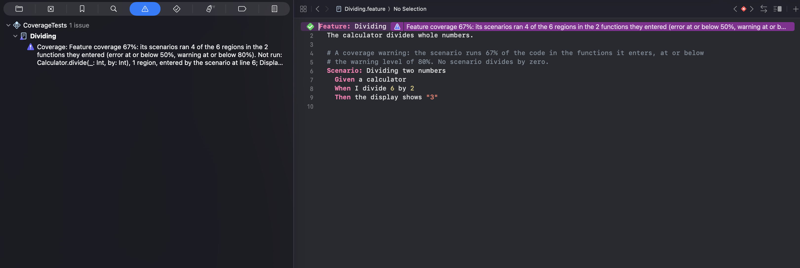
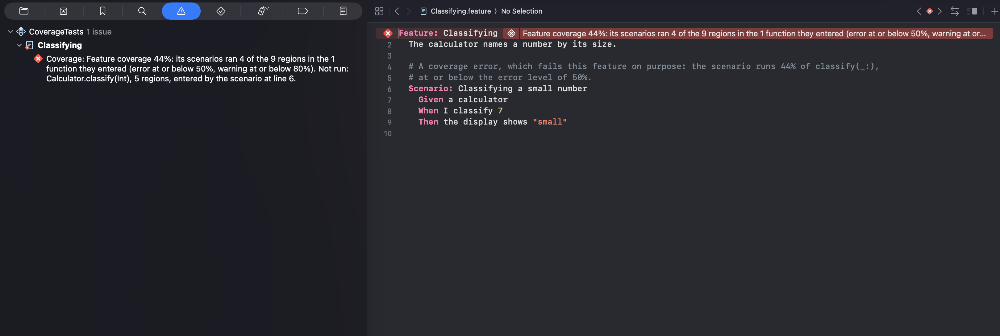
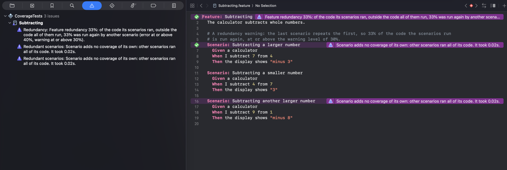

# Coverage

Code coverage scores for each feature: a macOS unit test bundle runs four feature files against a
framework, and CucumberSwift scores how much of the framework's code each feature's scenarios test,
and how much of it they test more than once. Each feature file is a demo of one issue that the
scores raise.

**CucumberSwift version:** 6.8.0 or later, the first release that measures coverage.

[Coverage in the documentation](https://cucumberswift.org/CucumberSwiftSample/documentation/cucumberswiftsample/coverage/) says what it shows, its platform and test target, and the Xcode and CucumberSwift it needs.

## What it shows

The sample has a framework, `Sources/Calculator`, and a feature file for each issue that the scores
raise:

| Feature file | Issue on the `Feature:` line |
|---|---|
| `Dividing.feature` | A coverage warning, at or below 80% |
| `Classifying.feature` | A coverage error, at or below 50% |
| `Subtracting.feature` | A redundancy warning, at or above 30% |
| `Adding.feature` | A redundancy error, at or above 40% |

CucumberSwift records each feature's issues in tests of its own, which run after the feature's
scenarios: `Coverage`, `Redundancy` and `Redundant scenarios`, in a suite named after the feature,
such as `Adding › Coverage scores`. The errors fail Classifying's `Coverage` test and Adding's
`Redundancy` test on purpose, and every scenario passes. Xcode shows the warnings in purple and the
errors in red, as it shows every issue that a test records.

`Project.swift` turns on code coverage for the `Calculator` framework only, and sets four
environment variables for the tests:

- `CUCUMBER_COVERAGE` turns on the coverage scores.
- `CUCUMBER_REDUNDANCY` adds the redundancy score.
- `CUCUMBER_REDUNDANCY_ERROR_LEVEL` sets the redundancy's error level to 40%. It is off by default.
- `CUCUMBER_COVERAGE_PATH` is the folder for each scenario's coverage file.

## Run it

You need Xcode 16.3 or later and [mise](https://mise.jdx.dev), which installs the version of
[Tuist](https://tuist.dev) this repository pins. Until CucumberSwift 6.8.0 is released, build
the sample against a CucumberSwift checkout that has the feature: see
[Use a local CucumberSwift checkout](../../README.md#use-a-local-cucumberswift-checkout). From the
repository root:

```bash
mise install
mise run generate
open Tuist/Coverage/Coverage.xcodeproj
```

Press ⌘U to run the tests, then open each feature file in `Tests/Features`. Classifying's and
Adding's `Coverage scores` tests fail on purpose with the errors.

From the command line, `mise run test Coverage` generates the project and runs its tests. It
fails unless those are the only failures, each feature scores in its ranges, and the tests write a
coverage file for each scenario.

## Read the scores

CucumberSwift prints each feature's scores when the feature finishes, with each scenario's share of
the coverage, the regions that no other scenario ran, and its time:

```
CucumberSwift coverage: Subtracting: 100% of the code its scenarios ran (4 of 4 regions in 2 functions), 15% of all measured code, redundancy 33%
    Share  Own regions      Time  Scenario
      29%            0     0.01s  Subtracting a larger number (line 6, adds no coverage of its own)
      42%            1     0.02s  Subtracting a smaller number (line 11)
      29%            0     0.01s  Subtracting another larger number (line 16, adds no coverage of its own)
```

Xcode shows each feature's issue on its `Feature:` line. The coverage issues name the functions
whose code no scenario ran:

```
Feature coverage 44%: its scenarios ran 4 of the 9 regions in the 1 function they entered (error at or below 50%, warning at or below 80%). Not run: Calculator.classify(Int), 5 regions, entered by the scenario at line 6.
```

Xcode 26 shows the warnings in the feature files. With Xcode 16.3, CucumberSwift prints them
instead, and still records the errors.

### A coverage warning

`Dividing.feature` shows a coverage warning. Coverage 67%: no scenario divides by zero, so the scenario runs 4 of the 6 regions in the functions it enters. That is at or below the warning level of 80%.



### A coverage error

`Classifying.feature` shows a coverage error. Coverage 44%: the scenario runs one of the six cases of `classify(_:)`. That is at or below the error level of 50%, so the feature fails on purpose.



### A redundancy warning

`Subtracting.feature` shows a redundancy warning. Redundancy 33%: the last scenario subtracts a larger number, as the first does. That is at or above the warning level of 30%, and the two scenarios have a warning that they add no coverage of their own.



### A redundancy error

`Adding.feature` shows a redundancy error. Redundancy 50%: three scenarios add positive numbers. That is at or above the error level of 40% that the scheme sets, so the feature fails on purpose, and the three scenarios have a warning that they add no coverage of their own.


## What CucumberSwift writes

Each run also writes a folder, `coverage/run-<id>`, next to `Project.swift`. The folder contains a
`manifest.json` with each feature's scores, and one `.profraw` file for each scenario and each
binary that was built with code coverage:

```
coverage/run-FD8D4D93-D558-43DB-AB32-FC42A11C0DBB/
    manifest.json
    S0001-L8-Calculator.profraw
    S0002-L13-Calculator.profraw
    …
```

A file's name starts with the scenario's position in the run and its line in the feature file.
Each file contains the coverage of one scenario only, for `llvm-cov` or a coverage report of your
own.

## Check the feature files as you build

`Project.swift` adds CucumberSwift's `CucumberSwiftLint` plugin to the test target, so each
build checks the feature files and shows each problem as a warning at its line. It has no
warnings for this sample. Keep it on for a build server too, with `-skipPackagePluginValidation`: see
[GettingStarted](../GettingStarted/README.md#check-the-feature-files-as-you-build).

## Turn it on in your own project

Set `CUCUMBER_COVERAGE` to `YES` in the test environment, and build the targets you want
measured with code coverage: in Xcode, the **Code Coverage** option of the scheme or test plan,
and in a Swift package, `swift test --enable-code-coverage`. Set `CUCUMBER_REDUNDANCY` to `YES`
for the redundancy score, and the levels with `CUCUMBER_COVERAGE_WARNING_LEVEL`,
`CUCUMBER_COVERAGE_ERROR_LEVEL`, `CUCUMBER_REDUNDANCY_WARNING_LEVEL` and
`CUCUMBER_REDUNDANCY_ERROR_LEVEL`. Each setting has a static variable on `Cucumber` too, such as
`Cucumber.coverage`, which you set in `setupSteps()`. In the scheme, Xcode expands
`$(PROJECT_DIR)` in an environment variable only when the scheme expands variables based on a
target, as `Project.swift` sets it with `expandVariableFromTarget`.

[Measuring code coverage](https://cucumberswift.org/CucumberSwift/documentation/cucumberswift/measuring-code-coverage)
describes the scores, the levels you can set, the code CucumberSwift measures, and the limits.

## Learn more

CucumberSwift's documentation goes further:

- [Measuring code coverage](https://cucumberswift.org/CucumberSwift/documentation/cucumberswift/measuring-code-coverage)
  in CucumberSwift's documentation.
- [GettingStarted](../GettingStarted/README.md), the smallest working setup.
